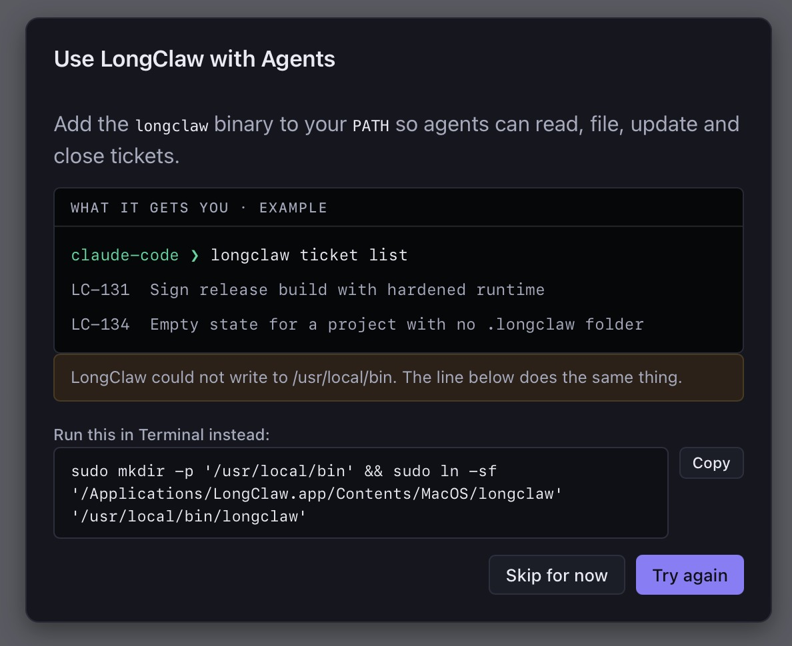

After installing LongClaw on a new Mac — especially Apple Silicon (M series) — the *Use LongClaw with Agents* intro dialog cannot install the `longclaw` command. Pressing Install CLI (then *Try again*) shows "LongClaw could not write to /usr/local/bin. The line below does the same thing." and offers a `sudo mkdir -p … && sudo ln -sf …` line to paste into Terminal. The one-press path never succeeds, so the only way through is to leave the app, open Terminal, and type an administrator password there. That is the install step this screen exists to save someone (LC-233).

Where it comes from: `install_command_line` in `src-tauri/src/platform/macos.rs` links `/usr/local/bin/longclaw` as the signed-in user. `/usr/local/bin` is root-owned (or missing) on a Mac that never had Homebrew for Intel installed, so `symlink` gets EACCES and the refusal path returns the copy-paste command. That is designed behaviour from LC-233, so on a stock Apple Silicon Mac the refusal is the common case, not the exception. LC-233 left escalation open only if the plain symlink proved insufficient in practice; this is that case.

The fix is specified in the spec recorded as this ticket's reference: an administrator prompt from inside the app, through one shared privileged module. The review's decisions and the settled copy deck stay here, as the prototype rules require.

## Review decisions (prototype, 2026-11-19)

The prototype was `docs/ux/prototypes/LC-285r-Install-The-Command-With-An-Administrator-Prompt.html`, deleted once settled; see `docs/ux/prototypes/README.md` for the commit that holds it.

- **A · In place.** No warning before the press: the button reads `Install` (or `Point it at this app`), and macOS's password sheet simply appears when it is needed (Q5-B).
- **When the sheet appears (Q4-A).** The plain write is tried first, and the sheet appears only when it is refused with `EACCES`. A Mac whose `/usr/local/bin` is writable never sees a prompt. A full disk, a read-only volume and an occupied path are never escalated.
- **B · The flow / behind the sheet.** The primary reads `Waiting for your password`, disabled, and `Skip for now` is disabled too; a polite live region says macOS is asking for a password. When the sheet closes, focus returns to the dialog's primary.
- **C · The sheet.** LongClaw passes macOS one sentence, `mac.prompt`, through AppleScript's `with prompt`; macOS draws everything else.
- **D · Cancelled.** Not a refusal and not `Try again`: "Nothing was installed." and the same `Install` button, which brings the sheet back. No `sudo` line. Closing the dialog after a cancel counts as a skip and raises the skipped toast.
- **E · Failures.**
  - **Password refused** (three wrong tries, or a standard account): the refusal and the `sudo` line, for someone else who administers the Mac. `Try again` brings the sheet back.
  - **Disk full:** the refusal and no `sudo` line, since `sudo` cannot make room. `Try again` re-writes and does not escalate.
  - **Occupied path:** no button, never escalated, with the reworded `status.occupied`.
- **Try again** appears only after a failure a second attempt could fix (a refused password, a full disk). It never repeats a write that is certain to fail the same way.
- **F · Installed.** Unchanged from today.
- **G · Installing later.** No new surface. The skipped toast names *Settings › Command line* (with *Open settings* inside a project), and the pane's *Ask again…* brings the dialog back. That holds after LC-261h removes the gear-menu row.
- **`refusal.denied` is deleted.** "LongClaw could not write to /usr/local/bin. The line below does the same thing." becomes unreachable: a refused write goes to the sheet, and a failed privileged script says `failed.script`.
- **Keyboard.** `keyboard-focus-map.md` has no section for the CLI offer, so the two keyboard rules are recorded here: both footer buttons are disabled while the sheet is up, and focus returns to the primary after it closes.

## Copy deck

Settled from the prototype. `{reason}` is the underlying error. `mac.prompt` is plain text in a system dialog.

| Id | Kind | Where | Text | Status |
| --- | --- | --- | --- | --- |
| `offer.title` | title | Intro dialog, heading | Use LongClaw with Agents | existing |
| `offer.title.done` | title | Intro dialog, heading after a successful install | `longclaw` is on your PATH | existing |
| `offer.lede` | note | Intro dialog and pane, first line | Add the `longclaw` binary to your `PATH` so agents can read, file, update and close tickets. | existing |
| `preview.caption` | caption | Terminal preview block | what it gets you · example | existing |
| `preview.caption.stale` | caption | Terminal preview block, stale link | what it is running today · example | existing |
| `button.install` | button | Dialog footer / pane header — the primary | Install | existing |
| `button.stale` | button | Primary, stale link | Point it at this app | existing |
| `button.installing` | button | Primary, disabled, during the write | Installing… | existing |
| `button.waiting` | button | Primary, disabled, while macOS's password sheet is up | Waiting for your password | new |
| `button.retry` | button | Primary, after a failure that a second attempt could fix | Try again | existing |
| `button.skip` | button | Dialog footer, dismissal | Skip for now | existing |
| `button.done` | button | Dialog footer, after success | Done | existing |
| `button.close` | button | Dialog footer, nothing to install | Close | existing |
| `button.copy` | button | Beside the Terminal line | Copy | existing |
| `mac.prompt` | system prompt | macOS password sheet — the sentence LongClaw supplies (`with prompt`) | LongClaw wants to add the longclaw command to /usr/local/bin. | new |
| `live.waiting` | live region | Dialog/pane live region while the sheet is up | macOS is asking for an administrator password. | new |
| `cancel.text.quiet` | note | Dialog/pane after the password sheet is cancelled | Nothing was installed. | new |
| `failed.admin` | refusal | After macOS refused the password (three wrong tries, or a standard account) | macOS did not accept an administrator password, so nothing was installed. If someone else administers this Mac, they can run the line below. | new |
| `failed.script` | refusal | After the privileged script itself failed (rare: e.g. the disk filled between check and write) | LongClaw could not install the command, even as an administrator: {reason} | new |
| `refusal.diskfull` | refusal | After the write failed because the disk is full | Installing the longclaw command failed: there is no space left on the disk. | existing |
| `manual.instead` | field label | Above the Terminal line, after a refusal | Run this in Terminal instead: | existing |
| `manual.yourself` | field label | Above the Terminal line, occupied path | To do it yourself: | existing |
| `a11y.copy` | aria-label | Copy button beside the Terminal line | Copy the install command | existing |
| `a11y.preview` | aria-label | Terminal preview block | Example of the longclaw command and its output | existing |
| `toast.copied` | toast | After Copy | Command copied | existing |
| `status.linked` | note | Pane, linked | `longclaw` is installed at `/usr/local/bin/longclaw` and points at this copy of LongClaw. | existing |
| `status.stale` | note | Pane and dialog, stale link | `/usr/local/bin/longclaw` points at `/Users/sam/Downloads/LongClaw.app/Contents/MacOS/longclaw`, which is not this copy of LongClaw. Re-linking replaces it. | existing |
| `status.occupied` | note | Pane and dialog, a file LongClaw did not create | LongClaw cannot replace `/usr/local/bin/longclaw`. Move it or rename it, then reopen this pane, or run the line below yourself. | changed |
| `toast.installed` | toast | After Done | longclaw is on your PATH. | existing |
| `toast.skipped` | toast | After Skip for now, inside a project | Skipped. Settings › Command line has it whenever you want it. | existing |
| `toast.skipped.welcome` | toast | After Skip for now, on the welcome screen | Skipped. Open a project, and Settings › Command line has it. | existing |
| `toast.skipped.action` | button | On the skipped toast | Open settings | existing |
| `pane.title` | title | Settings, pane heading / nav | Command line | existing |
| `pane.name` | label | Pane header | longclaw | existing |
| `pane.kind` | label | Pane header, beside the name | command-line interface | existing |
| `pane.askAgain` | checkbox | Pane footer | Ask again when I open a project without the command | existing |
| `pane.askAgain.hint` | hint | Pane footer, beside the checkbox | — off since you chose Skip for now | existing |
| `menu.row` | menu row | Gear menu | Command line tool | existing |
| `menu.hint.absent` | menu hint | Gear menu row | not set up | existing |
| `menu.hint.linked` | menu hint | Gear menu row | on PATH | existing |

## Checklist

- [ ] Reproduce on a clean Apple Silicon Mac with no writable /usr/local/bin <!-- longclaw:item=ck_a26ec01b -->
- [ ] Make the one-press install succeed without a Terminal paste <!-- longclaw:item=ck_6bcb0ecc -->
- [ ] Keep the occupied-file refusal: never replace a longclaw the app did not create <!-- longclaw:item=ck_a7503fbb -->
- [ ] Try again must not repeat a write that is certain to fail the same way <!-- longclaw:item=ck_eab24ad8 -->
- [ ] After install, a new terminal can run longclaw without extra PATH setup <!-- longclaw:item=ck_2e4f87fa -->
## Attachments

<!-- longclaw:attachment
id: att_459c90d7
file: attachments/att_459c90d7-cli-install-refused.png
name: cli-install-refused.png
media_type: image/png
size: 304070
added_at: 2026-11-11T11:19:33.343Z
added_by:
  type: agent
  id: claude-code
  name: Claude Code
-->
[cli-install-refused.png](./attachments/att_459c90d7-cli-install-refused.png)
<!-- /longclaw:attachment -->

<!-- longclaw:attachment
id: att_885fd837
file: attachments/att_885fd837-cli-install-m-series-refused.png
name: cli-install-m-series-refused.png
media_type: image/png
size: 304070
added_at: 2026-11-17T14:14:34.703Z
added_by:
  type: agent
  id: grok-build
  name: Grok
-->
[cli-install-m-series-refused.png](./attachments/att_885fd837-cli-install-m-series-refused.png)
<!-- /longclaw:attachment -->

## Ticket References

<!-- longclaw:reference
id: ref_ef021440
path: docs/ux/prototypes/LC-285r-Install-The-Command-With-An-Administrator-Prompt.html
added_at: 2026-11-18T15:36:18.074Z
added_by:
  type: agent
  id: claude-code
  name: Claude Code
-->
[LC-285r-Install-The-Command-With-An-Administrator-Prompt.html](../../../docs/ux/prototypes/LC-285r-Install-The-Command-With-An-Administrator-Prompt.html)
<!-- /longclaw:reference -->

<!-- longclaw:reference
id: ref_fbb8a7f3
path: docs/specs/LC-285r-install-the-command-with-an-administrator-prompt.md
added_at: 2026-11-19T14:06:16.721Z
added_by:
  type: agent
  id: claude-code
  name: Claude Code
-->
[LC-285r-install-the-command-with-an-administrator-prompt.md](../../../docs/specs/LC-285r-install-the-command-with-an-administrator-prompt.md)
<!-- /longclaw:reference -->

## Activity

<!-- longclaw:event
id: evt_1651ff9d
kind: create
occurred_at: 2026-11-11T11:19:28.711Z
actor:
  type: agent
  id: claude-code
  name: Claude Code
-->
### Claude Code created this ticket
<!-- /longclaw:event -->

<!-- longclaw:event
id: evt_04cb390a
kind: update
occurred_at: 2026-11-11T11:19:33.343Z
actor:
  type: agent
  id: claude-code
  name: Claude Code
changes:
  - field: attachments.att_459c90d7.added
    to: cli-install-refused.png
-->
### Claude Code updated this ticket
<!-- /longclaw:event -->

<!-- longclaw:event
id: evt_c4818930
kind: update
occurred_at: 2026-11-11T11:19:44.129Z
actor:
  type: agent
  id: claude-code
  name: Claude Code
changes:
  - field: description
-->
### Claude Code updated this ticket
<!-- /longclaw:event -->

<!-- longclaw:event
id: evt_c6d74331
kind: update
occurred_at: 2026-11-17T14:14:34.703Z
actor:
  type: agent
  id: grok-build
  name: Grok
changes:
  - field: attachments.att_885fd837.added
    to: cli-install-m-series-refused.png
-->
### Grok updated this ticket
<!-- /longclaw:event -->

<!-- longclaw:event
id: evt_de9f61d6
kind: update
occurred_at: 2026-11-17T14:14:49.598Z
actor:
  type: agent
  id: grok-build
  name: Grok
changes:
  - field: priority
    from: p1
    to: urgent
  - field: description
  - field: checklist.ck_a26ec01b.added
    to: Reproduce on a clean Apple Silicon Mac with no writable /usr/local/bin
  - field: checklist.ck_6bcb0ecc.added
    to: Make the one-press install succeed without a Terminal paste
  - field: checklist.ck_a7503fbb.added
    to: "Keep the occupied-file refusal: never replace a longclaw the app did not create"
  - field: checklist.ck_eab24ad8.added
    to: Try again must not repeat a write that is certain to fail the same way
  - field: checklist.ck_2e4f87fa.added
    to: After install, a new terminal can run longclaw without extra PATH setup
-->
### Grok updated this ticket

Raised to urgent after another report from a new Apple Silicon Mac: the intro dialog's Install CLI press lands on this refusal, and Try again cannot succeed. Screenshot attached (att_885fd837).
<!-- /longclaw:event -->

<!-- longclaw:event
id: evt_3eed93a6
kind: update
occurred_at: 2026-11-18T15:32:04.544Z
actor:
  type: agent
  id: claude-code
  name: Claude Code
changes:
  - field: description
-->
### Claude Code updated this ticket

Grilled the fix (admin prompt, shared privileged module) and built the UX prototype: docs/ux/prototypes/LC-285r-Install-The-Command-With-An-Administrator-Prompt.html. The open UX questions are listed in the description.
<!-- /longclaw:event -->

<!-- longclaw:event
id: evt_974b9aca
kind: update
occurred_at: 2026-11-18T15:36:18.074Z
actor:
  type: agent
  id: claude-code
  name: Claude Code
changes:
  - field: references.ref_ef021440.added
    to: LC-285r-Install-The-Command-With-An-Administrator-Prompt.html
-->
### Claude Code updated this ticket
<!-- /longclaw:event -->

<!-- longclaw:event
id: evt_c6553540
kind: update
occurred_at: 2026-11-19T13:21:04.713Z
actor:
  type: agent
  id: claude-code
  name: Claude Code
changes:
  - field: description
-->
### Claude Code updated this ticket

Applied prototype review 1: Q4-A, Q5-B, quiet cancel, no sudo line on disk full, two copy edits. Open items listed under Review 1.
<!-- /longclaw:event -->

<!-- longclaw:event
id: evt_e80e4d00
kind: update
occurred_at: 2026-11-19T13:26:22.672Z
actor:
  type: agent
  id: claude-code
  name: Claude Code
changes:
  - field: description
-->
### Claude Code updated this ticket

Prototype review settled: the remaining open questions took the recommended answers. The decisions and the copy deck are in the description; the prototype is deleted.
<!-- /longclaw:event -->

<!-- longclaw:event
id: evt_281f8715
kind: update
occurred_at: 2026-11-19T14:06:16.721Z
actor:
  type: agent
  id: claude-code
  name: Claude Code
changes:
  - field: references.ref_fbb8a7f3.added
    to: LC-285r-install-the-command-with-an-administrator-prompt.md
-->
### Claude Code updated this ticket
<!-- /longclaw:event -->

<!-- longclaw:event
id: evt_719d4a71
kind: update
occurred_at: 2026-11-19T14:06:16.747Z
actor:
  type: agent
  id: claude-code
  name: Claude Code
changes:
  - field: labels
    from: platform
    to: platform, ready-for-agent
  - field: description
-->
### Claude Code updated this ticket

Spec written to docs/specs/LC-285r-install-the-command-with-an-administrator-prompt.md and recorded as a reference; labelled ready-for-agent.
<!-- /longclaw:event -->
